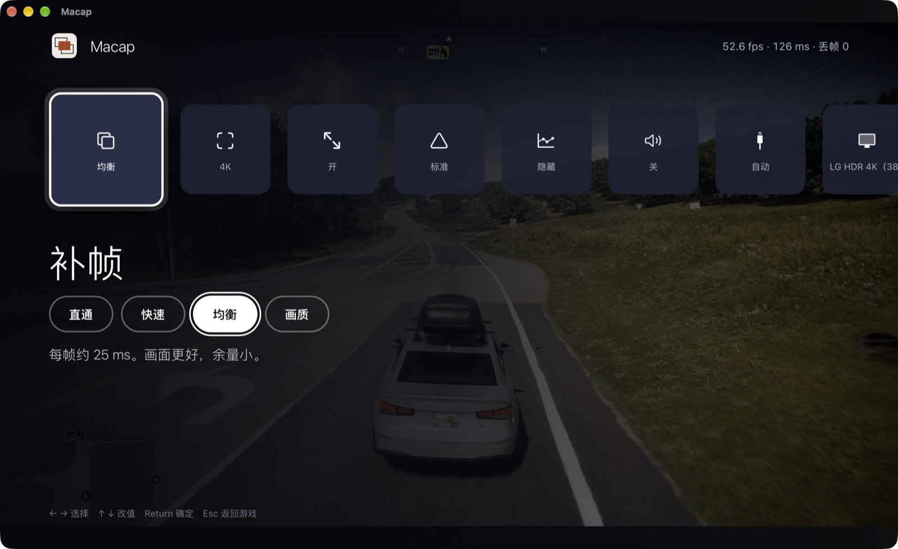

# Macap

[English](README.md) · **简体中文**

[](https://afdian.com/item/7710bd38e87e11f1b59e5254001e7c00) [](https://ko-fi.com/m2cha4l)

用 Mac 的显卡把 PS5 的 30 帧画面实时补到 60 帧。画面从 HDMI 采集卡读入，不走网络串流，也不录屏。界面支持英语、简体中文、印地语、西班牙语、阿拉伯语、法语和日语。

https://github.com/user-attachments/assets/f1690237-433f-407e-ae71-cc448c58586e

## 下载安装

1. 从[最新版本](https://github.com/M2cha4l/Macap/releases/latest)下载 `.dmg`，打开后把 Macap.app 拖进「应用程序」。
2. 打开 Macap。Macap 没有经过 Apple 公证，所以 macOS 第一次会提示无法验证开发者。点「完成」，打开 系统设置 › 隐私与安全性，滚到「安全性」，点「仍要打开」并确认。只需要做一次。
3. 允许摄像头和麦克风权限。
4. 按 `B` 测速。约 3 秒后弹窗给出这台 Mac 能稳定运行的设置，可以直接应用。



## 准备

1. Mac：Apple Silicon（M1 到 M5），macOS 14 或更新。
2. PS5 设置（设一次即可）：
   - 关闭 HDCP（设定 › 系统 › HDMI）。不关会黑屏。
   - 关闭 HDR、VRR 和 120Hz 输出。
   - 分辨率设为 2160p 或 1080p，60Hz。Macap 可以自己把 4K 缩到 2K。
   - 声音输出设为线性 PCM。
3. 免驱 UVC 采集卡：
   - 4K 或 2K：选支持 NV12 无压缩的 USB 3.0（5 Gbps）或 USB 3.2（10 Gbps）卡。
   - 1080p：普通 USB 3.0 1080p60 卡即可。
4. 接线：PS5 → 采集卡 HDMI IN；采集卡 USB-C → Mac（直插，不经过扩展坞）；Mac HDMI → 电视或显示器。

## 补帧档位

稳定 60 帧需要每帧 ≤ 25.5 ms（30 帧画面每 33.3 ms 来一张，再留出送屏余量）。

| 档位 | 按键 | 做法 |
|---|---|---|
| 直通 | `1` | 不补帧，不加延迟。60 帧游戏用这档。 |
| 快速 | `2` | 光流按 1/4 尺寸估算。 |
| 均衡 | `3` | 光流按 1/3 尺寸估算。默认档。 |
| 画质 | `4` | 光流按 1/2 尺寸估算。 |
| 系统补帧（720p / 分块） | `5` / `6` | macOS 自带补帧，需要 macOS 26。不在菜单里，只能用按键切换。 |

M5 Max（40 核显卡）实测，每帧耗时：

| 分辨率 | 快速 | 均衡 | 画质 |
|---|---|---|---|
| 4K | 6.0 ms | 11.1 ms | 23.3 ms |
| 2K | 2.9 ms | 4.2 ms | 10.3 ms |
| 1080p | 2.2 ms | 2.6 ms | 5.2 ms |

按机型的建议设置。除 M5 Max 外均按显卡规模估算，以 `B` 测速结果为准：

| 机型 | 建议设置 |
|---|---|
| M4 Max / M5 Max / Ultra | 4K + 画质；要更低延迟用 4K + 均衡 |
| M1 Max / M2 Max / M3 Max | 4K + 均衡 |
| M4 Pro / M5 Pro | 4K + 快速，或 2K + 均衡 |
| M1 Pro / M2 Pro / M3 Pro | 2K + 均衡；4K 只有快速勉强能跑 |
| M3 / M4 / M5（有风扇） | 2K + 快速，或 1080p + 均衡 |
| M1 / M2 基础版，所有 MacBook Air | 1080p + 均衡或快速；无风扇机型发热后降一档 |

## 按键

| 按键 | 作用 |
|---|---|
| `P` | 显示或隐藏设置。没有画面时设置一直显示。`←` `→` 选择，`↑` `↓` 改值，`Return` 确定，`Esc` 返回 |
| `F` / `⌘F` / 双击画面 | 全屏或窗口 |
| 右键 / `M` | 弹出菜单 |
| `B` | 测速 |
| `1`–`4` | 直通、快速、均衡、画质 |
| `X` | MetalFX 开关 |
| `K` | 锐化：关 / 标准 / 强 |
| `U` | USB 直读开关（10 Gbps 卡，需要先在菜单里安装组件） |
| `H` | 状态条：帧率、延迟、丢帧 |
| `S` | 保存最近 1 秒画面 |
| `Esc` | 先关设置，再退出全屏 |
| `Q` / `⌘Q` | 退出 |

画面上动一下鼠标，右下角会出现设置按钮。

语言在菜单栏 Macap › 语言 里切换，默认跟随系统语言。中英文以外的译文由 AI 翻译，欢迎母语用户提交修改：改 `Resources/<语言>.lproj/Localizable.strings`，再运行 `tools/i18n_check.py` 检查。

## 从源码构建

需要 Xcode 命令行工具。着色器在运行时编译，不需要 Xcode。

```sh
./build.sh                  # 构建 Macap.app
./tools/package_dmg.sh      # 干净构建、自检、打包 .dmg
```

## 已知限制

- 只适合 30 帧游戏。60 帧游戏按 `1` 用直通。
- 补帧大约增加 70–90 ms 延迟。手柄用有线连接 PS5 会更跟手。
- 镜头快速大幅转动时，人物边缘偶尔有半透明轮廓。
- 后台有占满显卡的任务（本地大模型、渲染）时，补帧会超时掉帧。

## 致谢

Macap 基于 GD古仔 的 CaptureInterp v1.0.0 开发（MIT 许可）。采集、补帧调度和 USB 直读来自 CaptureInterp；界面、档位、多语言和多项修复是 Macap 新加的。

## 许可

本仓库代码采用 MIT 许可（`LICENSE`）。`ThirdParty/RifeMetal` 基于 rife-metal（Apache-2.0）、OpenDuckFrame（MIT）和 Practical-RIFE 模型权重（MIT），见 `THIRD_PARTY_NOTICES.md`。
